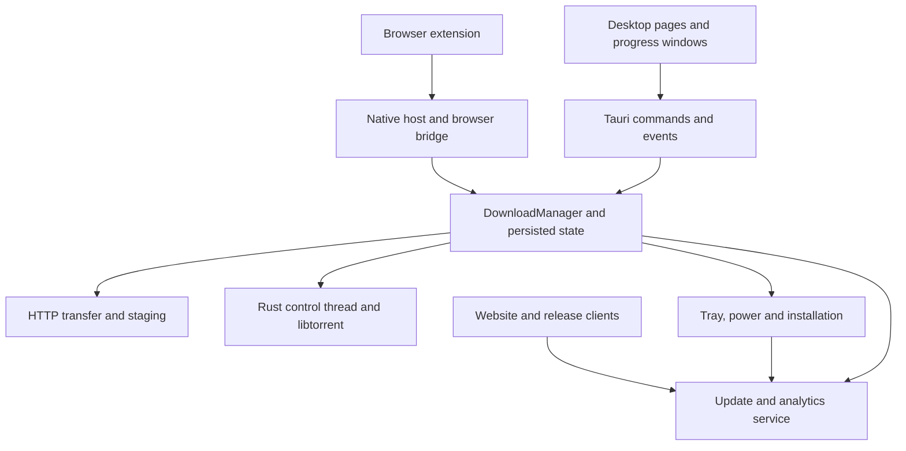

# Fetchrail: full audit and step-by-step repair plan

Audit date: 18 October 2026 (UTC)  
Project: `/fetchrail` (`C:\Users\lisbo\Downloads\fetchrail`)  
Application version: `0.7.4`  
Baseline commit: `f39a7f0feaeff112635ed9c4850c98b83acc0b40`

## How to use this document

This is the repair brief for the **current working tree**, including its existing uncommitted browser-session changes. Read the complete plan, reproduce each issue against the current source, and then implement the phases in order. The copy-and-paste agent prompt near the end provides the execution instructions.

This audit changed no application source. Its requested deliverable is this file. Existing changes in the repository belong to the user and must be preserved.

The report distinguishes three kinds of evidence:

- **Observed:** exercised in a test or UI walkthrough during this audit.
- **Code-traced:** a concrete failure path established by following the implementation and its callers; full native execution was unavailable where noted.
- **Validation gap:** a required check could not run, or an observed threshold failed without its underlying cause being established. A gap is not a claim that the product is broken in every environment.

No finite audit proves that an application has no other bugs. This plan covers the desktop interface, transfer engine, native lifecycle, storage, browser integration, website, update service, privacy, release mechanisms, and the available automated checks. It explicitly records the remaining qualification work.

## Baseline and constraints

The working tree already contained modifications to 17 tracked files (526 insertions and 90 deletions), plus `graphify-out/`, `scripts/test-browser-session-native.mjs`, and `src-tauri/src/browser_session.rs`. The modified files were:

```text
browser-extension/README.md
browser-extension/privacy-policy.txt
browser-extension/src/background.js
browser-extension/src/panel.css
browser-extension/src/panel.html
browser-extension/src/panel.js
docs/development.md
scripts/test-browser-batch.mjs
scripts/test-download-progress.mjs
scripts/test-downloads.mjs
scripts/test-extension-routing.mjs
src-tauri/src/browser_bridge.rs
src-tauri/src/lib.rs
src-tauri/src/model.rs
src-tauri/src/native_protocol.rs
src/App.tsx
website/public/privacy.html
```

There was no project `AGENTS.md` in the searched tree at audit time. A repair agent must check again before editing because instructions and files can change.

The host was Windows with Node `24.13.1`, Cargo `1.93.0`, and a separate installed stable Rust formatter. The complete Rust application could not compile because the pinned native libtorrent headers/libraries were missing. The isolated native browser-session harness did compile and pass.

The installed application was also labelled `0.7.4`, but some displayed torrent controls differed from the working tree. Consequently, the installed-app walkthrough supplies supplementary navigation/layout evidence. The current build and tests using simulated native responses supply source-specific UI evidence. Neither substitutes for a desktop build of the exact current revision.

## Surface and interaction coverage

| Surface | What was reviewed or exercised | Evidence and remaining limits |
| --- | --- | --- |
| Main download library | All/active/completed/failed/torrent/seeding/paused views; queue and status grouping; search; counts; selection; toolbar; empty states; theme switching | Source review, current UI fixtures, and installed-app navigation. Real transfer execution remains in the native qualification work. |
| New HTTP download | Link entry, destination, connection count, queue, SHA-256, start now/paused/scheduled, per-download limit | Source and fixtures; installed modal opened and closed without submitting a real download. |
| Batch/browser handoff | Deduplication, private/session-bound requests, credential context, fallback routing, selection and confirmation | Extension routing and batch suites passed; isolated Rust browser-session/protocol harness passed. A real signed browser extension/native-host round trip was not performed. |
| Download details and progress window | Live progress, segments, speed/ETA, pause/resume/cancel, per-task limit, tabs, completion options, open/close behavior, keyboard interactions | Current progress UI suite passed. Native transfer/error transitions need the full engine fixtures. |
| Torrent library | Large grouped lists, pause/resume, state changes, selection, telemetry | Current fixture used 1,000 transfers and 4 Hz telemetry. Functional checks passed; the inspector opening performance gate failed twice. |
| Torrent import | Magnet/file handoff, metadata, destination, file selection, select all/none, confirm/cancel | Source and fixture checks. Public peer networks and real payloads were not contacted. |
| Torrent inspector | Overview, files, priorities, trackers, peers, sharing limits, error display and close | Source; fixture with 10,000 files and 2,000 peers; narrow/light/dark screenshots generated. Remaining performance/recovery findings are listed below. |
| Settings: General | Theme/accent, preset/custom color, startup, tray, update status, immediate appearance changes | Source, installed navigation, current UI checks. Accent suite passed 1,100 cases in both themes. |
| Settings: Downloads | Destination, parallelism, removal policy, global speed limit, Windows attachment checks | Source/current UI tests; settings failure semantics require the repair work below. |
| Settings: Queues | Create/delete/pause, start/stop scheduling, default queue behavior | Source and current fixture interactions; native scheduler edge cases require engine tests. |
| Settings: Categories | Extension matching, category folders, add/remove, organize/move-back controls | Source and installed navigation. No user files were reorganized during the audit. |
| Settings: Torrents | Transfer/sharing/network/proxy configuration and licensing controls | Source and installed navigation; current native application compilation was blocked. |
| Settings: Browser | Default browser/store routing, manual installation guidance, repair/copy diagnostics | Source and mocks; actual installation/repair was not invoked against the user's browser. |
| Settings: Privacy | Consent, refusal, revocation, re-consent, cross-window synchronization and failed writes | Current analytics UI suite passed; no user consent was changed in the installed app. |
| Performance optimization | Explicit start, online/offline and upload choices, data/disk budgets, cancel, apply, copy, reset, uncertainty and responsiveness | Source and current UI fixture checks passed. No real calibration consumed the user's bandwidth or disk budget. |
| Hardware diagnostics | Stage progression, scores/grades, estimates, redacted copy, per-run sharing, cancellation, reduced motion and themes | Original test failed because of locale assumptions; the complete isolated en-US fixture run passed. Real hardware/network measurements were not run. |
| Setup, first-run and startup recovery | Destination/look choices, installation/error/update/uninstall flows, preserved-state recovery affordances | Source and setup paths exercised by current UI fixtures. User state was not deliberately corrupted or restored. |
| Native lifecycle | Close-to-tray, process shutdown, power/completion actions, update/restart failures, platform capability restrictions | Source trace and safe UI checks. Real shutdown, restart, disconnect, installer and uninstall actions were intentionally not triggered. |
| Browser extension | Toolbar/panel, page/context-menu download, redirects, sender isolation, credential scope, retry/fallback and session lifetime | Read-only code audit plus passing extension suites. Store publication and browser permission prompts need controlled integration validation. |
| Public website | Home, Windows download, Linux download, browser integration, interrupted-download guide, IDM comparison, privacy, 404, theme and release/download controls | Source audit and passing website/link/metadata/feed tests. This was not a live production deployment or a complete device/browser visual matrix. |
| Update/analytics service | Manifest policy, immutable publication, OIDC checks, rollback/concurrency, caching/ETag, store badge routing, analytics schema/auth/cardinality/retention | Full local service suite passed after installing pinned test dependencies, including Miniflare and SQLite-backed worker tests. Production credentials and deployment were not exercised. |
| Packaging/release | Version agreement, inventory/checksums/signatures, feed aggregation, download asset selection, store-change gating, release-note baselines | Release checks passed; source audit of integration/release paths. No release, push, tag, signing or publication occurred. |

## Architecture relevant to the repair



The most consequential repairs cross ownership boundaries. A successful disk write, an emitted event, a native command and a visible UI update are separate events; failures between them must have a defined outcome. Preserve the existing separation between transfer work, native torrent control, UI rendering, browser request context and remote publication policy.

## Repair index and priority

There are **16 actionable repair/validation items**: one P1 storage/security item, twelve P2 behavior or performance items, and three P3 resilience/test/documentation items. FR-005 is an observed failing performance gate whose underlying cause still needs profiling; it is not an established component-level diagnosis.

P1 means address the sensitive-storage defect first. P2 means a user-visible correctness, recovery, interaction or measured performance issue. P3 means a narrower resilience, test-portability or documentation repair. No P0 emergency or confirmed remote compromise was established.

| ID | Priority | Issue | Evidence | Phase |
| --- | --- | --- | --- | --- |
| FR-006 | P1 | Settings saves bypass protected storage; setup reader ignores envelopes | Independent source trace | 1, first |
| FR-001 | P2 | Failed completion power action leaves the manager closed to commands | Independent source trace | 1 |
| FR-002 | P2 | Failed settings saves can already have committed changes | Independent source trace | 1 |
| FR-007 | P2 | HTTP remove/delete succeeds despite failed file deletion | Independent source trace | 1 |
| FR-008 | P2 | Schedule and queue reassignment race transfer admission | Independent source trace | 1 |
| FR-009 | P2 | Stale full-settings writes overwrite newer preferences | Independent UI/native trace | 3; follows settings fixes |
| FR-010 | P2 | Initial snapshots overwrite newer live events | Independent source trace | 3 |
| FR-011 | P2 | Torrent polling can undo file exclusions | Independent source trace | 3 |
| FR-012 | P2 | Custom modals lack keyboard focus containment | Independent source trace | 3 |
| FR-013 | P2 | Lost handoff responses leave orphan/duplicate transfers | Source trace + isolated client reproduction | 2 |
| FR-014 | P2 | Extension reload discards active private batches | Source trace + isolated client reproduction | 2 |
| FR-015 | P2 | Same-URL request collisions misassociate credentials/batches | Source trace + isolated client reproduction | 2 |
| FR-005 | P2 | First torrent inspector opening fails performance budget | Failed gate in two runs; profile required | 4 |
| FR-003 | P3 | Performance status polling stops after one rejection | Source-traced error recovery | 3 |
| FR-004 | P3 | Diagnostics test assumes an English decimal separator | Original failure + isolated passing control | 4 |
| FR-016 | P3 | Companion installation guidance conflicts between pages | Repository content comparison | 5 |

The complete native build and platform qualification are additional release gates, recorded in the validation ledger. They are not extra invented product defects.

## Detailed repair items

### FR-001 — Failed completion power action leaves the manager permanently closing

**Priority:** P2. **Evidence:** independently code-traced. **Area:** completion actions and native lifecycle.

**Source:** `src-tauri/src/download_window.rs:126-149`; `src-tauri/src/engine.rs:1537-1545, 2533-2623, 5980-5982`; admission checks such as `engine.rs:3012-3015`.

**Trigger and impact:** A completed HTTP download has “turn off computer” enabled and “exit app” disabled. The platform action fails, for example because the OS denies shutdown or a requested Windows disconnect operation fails. The application remains open and displays an error, but subsequent operations guarded by `reject_diagnostics` reject with “Fetchrail is shutting down.” until the application restarts.

**Cause:** `on_completion` calls the terminal `DownloadManager::shutdown()`, which permanently sets `closing = true` and quiesces work. The failure handler only calls `resume_dispatch()`, which clears `dispatch_suspended`; it never clears `closing`. Shutdown also pauses work and stops auxiliary activity, so changing one flag without considering the rest of the state is incomplete recovery.

**Repair steps:**

- [ ] Separate reversible preparation for a power action from terminal application shutdown, or add an explicit, synchronized recovery path with defined state restoration.
- [ ] On failed power/disconnect action, return the manager to an operable state, publish authoritative state, and preserve the error message.
- [ ] Define what happens to transfers paused by the preparation step. Preserve deliberately paused tasks and user queue choices; do not blindly resume everything.
- [ ] Keep terminal exit/restart shutdown closed to new work.
- [ ] Handle timeout and repeated/concurrent completion actions without reopening an actual shutdown.

**Acceptance:** Use a fake platform action or the isolated fixture's machine-action refusal. After a failed completion power action, a new download can be added and an existing paused download resumed; no real shutdown occurs. Verify genuine exit still rejects admission and persists/checkpoints work. Cover shutdown preparation timeout and two near-simultaneous completions.

### FR-002 — A failed settings save can already have committed settings and side effects

**Priority:** P2. **Evidence:** code-traced. **Area:** settings consistency across storage, native runtime and UI.

**Source:** `src-tauri/src/engine.rs:3470-3521`, `engine.rs:2303-2358`; native error/timeout paths in `src-tauri/src/torrent.rs:92-107`; UI callers in `src/App.tsx:875-916`.

**Trigger and impact:** Change settings while torrent records/imports exist and a native `configure` operation fails or times out. The UI reports a failed save and retains its old saved-state model, even though `settings.json`, in-memory settings and potentially the HTTP limiter have already changed. The tray atomic and settings event are skipped. Separately, startup registration is changed before the file write, so a persistence error can change OS startup behavior while the save reports failure.

**Cause:** `update_settings` performs OS registration, durable write, in-memory replacement and performance-policy changes before awaiting another fallible operation. The `?` at `apply_torrent_budget` exits before the canonical settings event and remaining in-memory effects. The UI reasonably treats rejection as a failed commit.

**Repair steps:**

- [ ] Establish a single commit point and explicit outcome for settings updates.
- [ ] Validate reversible inputs before commit. Ensure a rejected persistence operation does not leave unreported OS registration changes.
- [ ] Once desired settings are durably committed, synchronize canonical in-memory/UI state even if a native application step fails. Surface a separate runtime-application warning with a safe retry/reconciliation path, or implement fully verified rollback.
- [ ] Treat a native timeout as an uncertain outcome; refresh/reconcile before replaying mutations.
- [ ] Apply the same contract to immediate appearance/remembered-choice changes and to calibration callers of settings updates. Preserve analytics consent ownership and unrelated unsaved edits.

**Acceptance:** Inject settings-file write failure, startup-registration failure, native configure rejection and native timeout. For each, disk, settings snapshots, event subscribers, tray behavior and limiter state must agree with the reported outcome. Two open windows must converge. A retry must not overwrite later user edits or claim that committed changes were discarded.

### FR-003 — A transient performance status error permanently stops polling

**Priority:** P3. **Evidence:** code-traced error recovery; not reproduced in a live native calibration. **Area:** Performance optimization page and invitation.

**Source:** `src/Performance.tsx:19-36` (`useStatus`); page action/state consumers at `Performance.tsx:68-85`.

**Trigger and impact:** A `performance_status` request rejects once, including while calibration is running. No further timer is scheduled. The UI keeps the previous status and can continue showing a run as active after the native run completes, until the page is remounted or another successful action changes state.

The current ordinary native status handler returns success; the reproduction needs an injected or transient IPC rejection. The audit did not observe a real calibration failure from this path.

**Cause:** The next poll is scheduled only inside the successful `try` branch. The `catch` stores an error but does not resume polling, and the effect dependencies do not change merely because an error occurred.

**Repair steps:**

- [ ] Keep a single non-overlapping polling loop alive after transient failures, with bounded backoff.
- [ ] Display the error/staleness state while preserving useful last-known information.
- [ ] Clear the error when a later request succeeds.
- [ ] Cancel timers and ignore late results on unmount; avoid duplicate loops when `running` changes.
- [ ] Preserve the invitation's intended lower polling cost while idle.

**Acceptance:** A fake native status endpoint succeeds, rejects once, and then reports completion. Without remounting, the page must recover, show completion and re-enable the appropriate actions. Also test initial failure, repeated failures, transition between running/idle, and unmount with a request pending.

### FR-004 — Diagnostics UI test assumes an English decimal separator

**Priority:** P3. **Evidence:** observed and isolated. **Area:** test portability.

**Source:** `scripts/test-diagnostics-ui.mjs:26, 175-184`; locale-aware product formatting at `src/Diagnostics.tsx:22`.

**Trigger and impact:** Run the test in a browser using pt-PT. The product correctly renders `62,5 MB/s`, but the assertion requires `62.5 MB/s`, so the test fails before later diagnostics assertions execute. Other hard-coded decimal assertions have the same assumption.

**Evidence from this audit:** The host browser reported pt-PT. The original suite failed at the first throughput assertion. An isolated copy with `locale: "en-US"` passed the full suite. The original test was left untouched.

**Repair steps:**

- [ ] Set an explicit browser locale for fixtures whose expected copy is English.
- [ ] Add one focused non-English locale case using locale-aware expected formatting or assertions that check the numeric meaning and unit.
- [ ] Review nearby hard-coded decimal expectations for the same assumption.
- [ ] Preserve the product's localized number formatting; do not change the app to an English decimal separator just to satisfy the test.

**Acceptance:** The standard suite passes regardless of the host's locale. An explicit pt-PT case verifies the comma decimal display and still checks the intended measured value.

### FR-005 — Torrent inspector first-open performance fails the existing budget

**Priority:** P2 investigation and repair. **Evidence:** observed failed gate; underlying cause unconfirmed.

**Source:** `scripts/test-torrent-ui.mjs:53-76, 116-122`; inspector implementation in `src/Torrents.tsx` and its mount in `src/App.tsx`.

**Trigger and impact:** Run `npm run torrent:ui` with its large-list fixture. The ten-open p95 exceeds the 100 ms budget because the first inspector opening takes 268.8 ms, then 187.8 ms in a repeat. Later opens are approximately 19–33 ms. Both runs had no recorded steady-state long tasks or JavaScript errors.

**Repair steps:**

- [ ] Preserve the fixture and raw metrics; capture a performance trace specifically for the first inspector mount.
- [ ] Separate script/module work, React rendering, metadata transformation, style/layout, font readiness and simulated IPC timing.
- [ ] Verify the budget in the documented browser/runtime on an otherwise idle host, including a cold first opening.
- [ ] Fix the measured cause with the smallest relevant change; retain virtualization for transfers, files and peers.
- [ ] Keep first-open measurements separate from warm interactions. If the measurement itself is invalid, document that with a trace and revise the test method; do not simply raise the threshold or discard the slow first sample.

**Acceptance:** The first opening and the defined p95 meet the agreed existing budget on the documented test environment, with no regression in the 15-second 4 Hz telemetry check, keyboard behavior, file selection, peers scrolling or narrow layouts. Record before/after raw samples and environment. If a hardware-specific budget adjustment is justified, state the evidence and leave no misleading “performance fixed” claim.

### FR-006 — Settings writes bypass protected storage; setup also bypasses the matching reader

**Priority:** P1 for credential persistence; the associated setup-reader defect is P2. **Evidence:** independently code-traced. **Area:** settings storage, privacy changes and Windows setup.

**Source:** `src-tauri/src/engine.rs:3484, 5906-5913, 6035-6066, 6381-6387`; `src-tauri/src/state_store.rs:44-54, 91-106`; `src-tauri/src/torrent.rs:150-169`; `src-tauri/src/platform/mod.rs:124-155`; setup caller `src-tauri/src/lib.rs:664-695`.

**Trigger and impact:** Configure a torrent proxy password, then save settings or change analytics consent. Those two write paths serialize ordinary JSON directly instead of using the protected state catalog. On Windows, the password is consequently written without the intended user-scoped DPAPI protection. On Linux, those paths also bypass the existing rule that removes the proxy password from persisted settings. The direct writes skip the catalog's validated-generation backup mechanism.

The private atomic writer still applies restrictive file access; this finding does not establish that the file is world-readable or that credentials were transmitted remotely. It establishes an unintended plaintext persistence path when a proxy password is present.

There is a related reader mismatch: `saved_settings()` parses raw bytes as `DownloadSettings`, although normal startup writes a state envelope. Windows setup calls that reader and falls back to default theme, accent, startup preference, category sorting and download folder. Re-running setup with a valid enveloped settings file can therefore display defaults; accepting them can overwrite the user's previous choices through setup launch arguments (`install.rs:105-124`, `model.rs:249-276`).

**Repair steps:**

- [ ] Create one canonical settings storage helper. Apply the platform secret policy to a persisted copy, then use the envelope/validated-backup writer for every settings write.
- [ ] Route ordinary saves, immediate changes, analytics consent, startup persistence and setup-related changes through that helper.
- [ ] Keep the live Linux proxy password available for the session while excluding it from persisted primary **and backup** settings.
- [ ] Handle existing plaintext settings and previously persisted secrets during migration. Merely scrubbing the new value is insufficient: the generic backup writer currently copies the previous value, which can retain a Linux password in a backup.
- [ ] Change `saved_settings()` to use the canonical envelope-aware reader while retaining supported legacy migration behavior.
- [ ] Preserve current privacy withdrawal behavior when persistence fails, unknown supported settings fields, restrictive permissions and validated recovery generations.

**Acceptance:** Use synthetic sentinel passwords. On Windows, ordinary save and consent changes produce protected envelopes; primary and backup do not contain the plaintext sentinel and decode correctly for the intended account. On Linux, decode both primary and backup and assert the password is empty/absent while live configuration retains the session value. Cover legacy plaintext and old envelope migration, a failed write, primary corruption/backup recovery, and setup opened over customized enveloped settings. Setup must display and preserve the existing folder/look/startup choices.

**Dependency:** Repair this storage contract before FR-002's commit semantics and FR-009's settings mutation API.

### FR-007 — HTTP removal reports success after requested file deletion fails

**Priority:** P2. **Evidence:** independently code-traced. **Area:** removal, filesystem errors and history.

**Source:** `src-tauri/src/engine.rs:3134-3154`; compare recoverable torrent removal at `engine.rs:2264-2290`.

**Trigger and impact:** Lock a completed HTTP payload against deletion on Windows, then choose removal with file deletion. The task is removed from memory first, filesystem errors are discarded, removal is persisted and success is returned. The file remains on disk while its history entry and convenient retry path disappear. Failed staging cleanup can likewise leave untracked partial files.

**Repair steps:**

- [ ] Perform requested cleanup before committing removal, or preserve a recoverable removal state until it succeeds.
- [ ] Treat a genuinely missing file as success; propagate permission, locking and other real filesystem failures.
- [ ] Keep a retryable record and a useful path/error message when requested payload deletion fails.
- [ ] Define how staging cleanup failure is represented. Do not claim complete deletion while silently discarding that error.
- [ ] Reconcile persistence failure so memory, emitted events and the next startup agree about whether removal committed.

**Acceptance:** Test an isolated locked payload, successful retry after unlocking, already-missing payload, history-only removal, staging cleanup failure and catalog persistence failure. A failed delete keeps a useful record; successful history-only removal preserves the payload.

### FR-008 — Schedule and queue changes race transfer admission

**Priority:** P2. **Evidence:** independently code-traced with UI reachability checked. **Area:** scheduler concurrency.

**Source:** `src-tauri/src/engine.rs:3397-3447, 3705-3718, 3837-3849, 3891-3934`; exposed queued-row controls at `src/App.tsx:1655, 1846-1864, 1906`.

**Trigger and impact:** The scheduler selects a queued task. Before it starts that candidate, a user's schedule change passes the `running == false` check and saves a future time. The scheduler then changes the selected `Scheduled` record back to `Queued`/connecting and starts it without checking the new eligibility. Reassigning a selected task to a paused queue has the same admission race.

**Cause:** `schedule()` and `assign_queue()` do not acquire the dispatch lock used by scheduler admission and other task mutations. The running check occurs before awaits and is not an atomic admission decision.

**Repair steps:**

- [ ] Serialize schedule and queue-assignment changes with the same dispatch lock as admission.
- [ ] Check running state and queue validity after obtaining the lock.
- [ ] Review queue deletion/mutation lock order and candidate revalidation so membership remains coherent without introducing a deadlock.
- [ ] Define the concurrent outcome: either transfer admission wins and the edit is rejected accurately, or the edit wins and the transfer honors it.

**Acceptance:** Use deterministic barriers around candidate selection and mutation. A future schedule that wins must prevent network work; movement into a paused queue must prevent admission. If admission wins, return a clear “pause first” result. Cover HTTP and torrents, plus normal scheduling of paused/failed/cancelled tasks. Predicate-only tests do not cover this interleaving.

### FR-009 — Stale full-settings writes undo preferences saved elsewhere

**Priority:** P2. **Evidence:** independently code-traced across UI and native handler. **Area:** multiple windows and settings ownership.

**Source:** `src/App.tsx:875-916, 3274-3300, 3311-3318`; `src-tauri/src/engine.rs:3474-3489`.

**Trigger and impact:** Leave a browser download confirmation window open. Save a new speed limit or other preference in the main window. Return to the old prompt and choose “Remember this folder.” The prompt sends its entire original settings object with the folder changed; the native handler replaces current non-analytics settings, silently reverting the newer preferences. A pending main save and an immediate appearance change can also overwrite one another.

**Repair steps:**

- [ ] Apply field-scoped settings patches to the latest native state under the existing settings lock, or use an explicit revision/conflict contract.
- [ ] Use narrow operations for appearance, remembered folder/category folder and remembered removal behavior.
- [ ] Have the main editor submit its actual edited fields rather than treating a whole stale object as authoritative.
- [ ] Subscribe the prompt to settings changes for accurate display, while keeping concurrency correctness in the native mutation boundary.
- [ ] Preserve the separate analytics consent command and retain unsaved edits after failed updates.

A frontend-only queue, a fresh read immediately before writing, or adding a settings listener alone does not resolve the cross-window read/modify/write race.

**Acceptance:** Prompt A remembers a folder after main-window change B; both survive reload. Delay a main save while changing the accent/theme and verify both completion orders. Open two prompts that update different category folders and preserve both choices. Inject failure and verify errors plus retained edits.

**Dependency:** Use FR-006's canonical storage and FR-002's accurate commit outcome.

### FR-010 — Late initial snapshots overwrite newer desktop events

**Priority:** P2. **Evidence:** independently code-traced. **Area:** initial window state and event reconciliation.

**Source:** `src/App.tsx:625-683`; existing careful single-record ordering at `src/DownloadProgress.tsx:35-62`.

**Trigger and impact:** Delay the initial queue request after the initial download snapshot has been captured. An add, removal, settings or queue event arrives and updates the UI. The eventual `Promise.all` completion blindly installs the older snapshots. A removed row reappears, a new paused/completed row disappears, or settings/queues revert visually. Items without continuing progress events may remain wrong indefinitely.

**Repair steps:**

- [ ] Establish subscriptions before requesting the baseline.
- [ ] Buffer events arriving during bootstrap, install the baseline, then replay them in order.
- [ ] Include removal events and queue/settings replacement semantics, or use a properly versioned snapshot/event protocol.
- [ ] Clean up pending subscriptions and ignore late async work on disposal.
- [ ] Do not use an indiscriminate array merge or skip the entire initial list after any event; those approaches can lose removals or untouched existing records.

**Acceptance:** Hold initial IPC responses and inject add, update, remove, add-then-remove, queue removal and settings changes. Include an untouched pre-existing item. The final UI matches authoritative state with no duplicates, resurrected records, lost baseline items or duplicate listeners. Cover unmount during registration/loading.

### FR-011 — Torrent polling can undo file exclusions and send them back to the engine

**Priority:** P2. **Evidence:** independently code-traced. **Area:** torrent file priorities and asynchronous state.

**Source:** `src/Torrents.tsx:24-33, 120-126, 138`.

**Trigger and impact:** A pending details response contains priorities `[4,4]` for files A and B. The user unchecks A, sending `[0,4]`. The old response then resets the UI to `[4,4]`. Unchecking B sends `[4,0]`, re-enabling A. A user's excluded files can download, consuming disk and bandwidth.

**Repair steps:**

- [ ] Separate pending user priority edits from polled snapshots.
- [ ] Serialize or coalesce priority mutations and associate read responses with a mutation generation.
- [ ] Ignore or reconcile responses captured before accepted local edits.
- [ ] On failure, clearly restore/reload authoritative state before constructing later full-array writes.
- [ ] Preserve final user intent through rapid toggles, select all/none and tab changes.

**Acceptance:** Hold an old details response across an accepted edit, then change a second file. The first exclusion remains applied. Test rapid changes and select all/none with delayed writes, a rejected mutation, and tab changes while a response is pending. Assert final engine priorities as well as checkbox appearance.

### FR-012 — Custom modal dialogs do not contain keyboard focus

**Priority:** P2. **Evidence:** independently source-traced; dedicated keyboard runtime verification remains required. **Area:** accessibility and modal interactions.

**Source:** New download dialog `src/App.tsx:1296-1445`; removal dialog `App.tsx:1572-1629`; torrent import `src/Torrents.tsx:78-90`; native-dialog precedent `src/Privacy.tsx:41-61`.

**Trigger and impact:** These dialogs use ordinary forms/sections with `role="dialog"` and `aria-modal="true"`, but do not trap focus or make the background inert. Tabbing can reach and activate underlying controls. Torrent import does not deliberately move initial focus into the modal. Escape does not dismiss New downloads or torrent import; removal only catches Escape while focus is inside its form.

**Repair steps:**

- [ ] Reuse a shared native `dialog`/ `showModal()` approach consistent with the privacy prompt, or implement equivalent focus containment and background isolation.
- [ ] Choose an initial focus target, wrap forward/backward Tab, and restore focus to the opener after closing.
- [ ] Define Escape and pending-operation behavior for each modal.
- [ ] Route torrent-import dismissal through its actual cancellation command so staged state is cleaned up.
- [ ] Check other confirmation surfaces against the same interaction contract without a broad visual redesign.

**Acceptance:** Keyboard-only tests verify initial focus, Tab/Shift+Tab containment, Escape, focus restoration and inability to activate background controls. Verify import cancellation cleanup and pending-action behavior. Test assistive-technology announcements in the supported desktop runtimes.

### FR-013 — Lost browser handoff replies leave orphan or duplicate app transfers

**Priority:** P2. **Evidence:** source trace plus isolated reproduction against the unmodified extension with simulated native responses. **Area:** browser/native transfer ownership.

**Source:** `browser-extension/src/background.js:289-299, 330-340, 417-458`; `src-tauri/src/browser_bridge.rs:209-239, 267-335`; `src-tauri/src/engine.rs:1624-1702, 2637-2651, 2688-2709, 2751-2758`; `src-tauri/src/native_host.rs:83-101`.

**Trigger and impact:** The app accepts and persists a browser download, then its native acknowledgement is lost. The extension has no returned `engineId`, so it cannot cancel the accepted app record and resumes the browser. A normal capture leaves a paused app record/prompt; an automatically starting batch can leave both transfers active. Retrying uses another UUID and can create another app record.

**Observed isolated result:** An accepted-add/lost-callback fixture produced `persisted: 1, cancelledInApp: 0, resumed: 1`. This was a client negative-path simulation, not a live native transport test.

**Repair steps:**

- [ ] Use the existing `handoffProtocol: 2`, `getHandoff` and `commitHandoff` mechanisms.
- [ ] Retain one stable handoff identifier per logical browser download, retained across retries, reconnects and worker recovery, and use it to reconcile uncertain stage and commit acknowledgements.
- [ ] Verify browser state and ownership before cancellation; preserve a recoverable transfer at every boundary.
- [ ] Recover normal worker restarts and define a privacy-preserving safe outcome when private context cannot be recovered.
- [ ] Avoid storing private URLs or credentials in shared browser storage.
- [ ] Preserve intended paused/scheduled behavior, confirmation prompts and batch options. Do not blindly replay uncertain mutations under a fresh identifier.

**Acceptance:** Drop replies after persisted staging and after commit; restart the worker between staging, browser cancellation and commit; race a browser user action with validation; retry the same ID. Verify exactly one app record and one active transfer owner, or a clearly recoverable paused state. Cover normal capture, automatic batches and private browsing using controlled native round trips after the client fixtures.

### FR-014 — Extension auto-reload destroys a waiting private batch

**Priority:** P2. **Evidence:** source trace plus isolated reproduction against the unmodified extension. **Area:** extension update and batch lifecycle.

**Source:** `browser-extension/src/background.js:67-95, 186-207, 262-287`.

**Trigger and impact:** Start a private browser batch, close its companion panel and leave it waiting for login or a countdown. Its queue is deliberately memory-only, and the initial action is no longer counted in `activeActions`. When an updated build marker appears, the one-minute update check can reload the extension, destroying the private queue/progress.

**Observed isolated result:** A waiting private batch, closed panel and changed valid build marker produced `reloads: 1`.

**Repair steps:**

- [ ] Treat active normal and private batches as reasons to defer reload.
- [ ] Cover both waiting and capturing states.
- [ ] Recheck immediately before `runtime.reload()` so a batch started during awaited work prevents the reload.
- [ ] Allow the pending update after the batch completes or is stopped.
- [ ] Keep private links memory-only; do not fix this by writing them to normal storage.

**Acceptance:** A changed build marker must not reload while a private/normal batch waits or captures, even with no panel open. Test a batch starting during the update check, then verify reload becomes possible after completion/stop. Preserve existing active-action/panel safeguards.

### FR-015 — Same-URL requests can supply another tab's credentials or batch identity

**Priority:** P2. **Evidence:** source trace plus isolated reproduction against the unmodified extension. **Area:** request correlation and privacy.

**Source:** `browser-extension/src/background.js:27-59, 382-393, 414-423`.

**Trigger and impact:** Two tabs in the same cookie store request the same URL, with different request IDs or Authorization headers. The request map key contains only private-mode state, cookie-store ID and URL; the later request replaces the earlier one. Download pickup then uses that last trace's tab, batch options and headers. A same-URL background XHR can also replace a download's trace.

This can apply the wrong queue/destination/batch association or retrieve the other account's file from the same endpoint. The audit did not establish an arbitrary-origin credential-exfiltration path.

**Observed isolated result:** After two synthetic authenticated requests for one URL, the map held one trace, belonging to tab 2 with `Bearer account-B`. That is the trace the routing lookup returns for either download.

**Repair steps:**

- [ ] Retain distinct observations by request identity and relevant browsing context, including redirect-chain ownership.
- [ ] Attach credentials or batch identity only when association with the actual download is unambiguous.
- [ ] Handle browser API limitations explicitly. Merely adding tab ID to a key does not work when the corresponding DownloadItem lacks it.
- [ ] On ambiguity, keep the transfer in the browser and give an actionable explanation instead of guessing.
- [ ] Preserve private/normal and Firefox-container separation, bounded retention and credential clearing.

**Acceptance:** Test simultaneous same-URL GETs with different synthetic accounts, a later same-URL XHR, redirect aliases, Firefox containers, private/normal overlap and different batch options. Ambiguous pickup must never attach another observation's credentials or batch settings. Verify actual Chromium and Firefox behavior after the pure routing fixture.

### FR-016 — Homepage and browser guide give conflicting companion installation instructions

**Priority:** P3. **Evidence:** repository content inconsistency; live store publication status was not checked.

**Source:** `website/public/index.html:474`; `website/public/browser-integration.html:28`; store-opening implementation at `src-tauri/src/browser_extension.rs:376-387`.

The homepage says the companion is loaded unpacked “for now,” while the dedicated guide offers a Chrome Web Store option and treats unpacked installation as an alternative. Users receive different setup instructions depending on their entry page.

**Repair steps:**

- [ ] Verify current official store availability before making a publication-status claim.
- [ ] Align the homepage, dedicated guide, Settings → Browser and maintained extension documentation around the actually supported choices and platform limits.
- [ ] Prefer one maintained installation guide as the detailed destination.

**Acceptance:** A user entering through the homepage or app sees consistent installation choices and reaches the appropriate guide/store/manual steps. Run website and extension routing/content checks. Do not change live store listings as part of this documentation repair.

## Review limits and safeguards to preserve

Independent reviewers completed bounded source reviews from read-only copies of the current files. Their first parallel connector requests returned no source; those attempts were not counted as coverage. The findings above use the later successful source reads, the direct test runs and the explicitly described isolated reproductions.

The engine already contains substantial safeguards for strong validators, redirect identity, Content-Range bounds, short/overlong bodies, durable partial-file hashes, collision-resistant publication and validated state recovery. The browser/bridge code already checks sender/native origins, message shape/size and credential scope. The service tests cover immutable signed-release publication policy and bounded, consent-based analytics handling. Preserve these mechanisms while fixing the gaps; their existence does not replace the blocked native runtime checks.

The following were reviewed or flagged for qualification but **were not promoted to confirmed defects**:

- The normal HTTP completion path sets its record to Completed before invoking completion actions, so the shutdown active-transfer loop does not wait for that same completing task.
- Queue schedule forms are keyed by their persisted schedule, so successful Clear/Save operations remount correctly. The selected torrent inspector is keyed by torrent ID, preventing one selected torrent's local state from simply carrying over to another.
- The diagnostics comma decimal separator is correct localized behavior; FR-004 is a test defect.
- Preserved incompatible/previous-source partial directories may be intentional recovery data. Before proposing retention cleanup, search all recovery/cleanup paths and define a user-visible recovery policy. Do not automatically delete preserved parts based on this audit.
- Torrent completion-action parity requires checking the actual UI/command contract before treating the absence of the HTTP callback in torrent polling as a bug.
- Older roadmap entries are historical evidence, not the current feature specification. Several previously listed transfer capabilities already exist in code; re-check before implementing duplicate mechanisms.
- Linux support/qualification limits already documented as experimental or pending require platform evidence. This Windows audit does not certify every Linux package, distribution, architecture, display server, GPU or power-policy combination.
- Website source and automated tests were reviewed, but a complete live responsive/keyboard/browser matrix and current external store/vendor claims were not verified.
- Zero npm advisories does not cover native libraries, application logic, or unknown vulnerabilities. No complete Cargo/C++ vulnerability scan was claimed.

## Validation ledger

These are results from this audit, not a promise that the repair is already implemented. Run the relevant checks again after changes.

| Command/check | Audit result | What the result means |
| --- | --- | --- |
| `npm run build` | PASS | Extension variants, TypeScript and Vite built the current frontend. The JavaScript bundle was about 460 kB before gzip / 135 kB gzip. This does not compile the Rust/C++ application. |
| `npm run browser:check` | PASS | Extension, routing and browser-batch suites passed, including Chromium/Firefox sender checks and credential/session routing fixtures. |
| `npm run release:test` | PASS | Release aggregation, trusted download selection, extension release-change gating and release-note baseline tests passed. |
| `npm run release:check` | PASS | Application and extension versions agreed at 0.7.4. |
| `npm test --prefix website` | PASS | Website metadata, links, canonical URLs, sitemap, structured data, source parity and release/download fixtures passed. |
| `npm test --prefix update-service` | PASS after dependency setup | Initial run lacked Miniflare. After `npm ci --prefix update-service --ignore-scripts --no-audit --no-fund`, the full policy/store-badge/worker suite passed. This included the actual local Worker runtime and SQLite behavior. |
| `node scripts/test-browser-session-native.mjs` | PASS: 8 tests | Compiled the isolated current Rust browser-session/native-protocol modules. Covered HTTP and torrent handoff, credential/header validation, scoped session options, single-use claims, controls, expiry/size/invalid requests. |
| `node scripts/test-download-progress.mjs @playwright/test` | PASS | Broad current UI fixtures passed: progress, setup flows, settings save/error behavior, navigation/keyboard, categories of controls, calibration budgets/cancel/apply/report/reset, Linux policy, update/restart errors and browser routing. Native responses were simulated. |
| `node scripts/test-analytics-ui.mjs @playwright/test` | PASS | Consent/revoke/error/re-consent/cross-window/keyboard/narrow-layout checks passed; the fixture saw no frontend analytics network calls. |
| `node scripts/test-accent.mjs` | PASS | 1,100 accent cases met the suite's 4.5:1 text-contrast checks in both themes and survived settings round trips. This is not a complete accessibility certification. |
| `node scripts/test-diagnostics-ui.mjs @playwright/test` | FAIL in host locale | The first decimal-format assertion expected `62.5 MB/s`; the host browser used pt-PT and rendered `62,5 MB/s`. See the diagnostics test issue below. |
| Isolated copy of the diagnostics test with `locale: "en-US"` | PASS | The entire suite then passed, including grades, estimates, redacted copy, per-run sharing, themes and reduced motion. The temporary script was removed; the checked-in test was not changed. |
| `npm run torrent:ui` | FAIL twice at the action-paint gate | Functionality and virtualization checks completed. First inspector opens were 268.8 ms and 187.8 ms; the gate is p95 < 100 ms. Both runs reported no JavaScript errors and no recorded steady-state long tasks. See the performance investigation item. |
| Isolated Node VM checks against unmodified extension source | Reproduced 3 defects | Lost native acknowledgement: one accepted app record, no app cancellation, browser resumed. Changed extension marker with waiting private batch: one reload. Same URL from two tabs: last trace replaced first, including synthetic Authorization. No real browser/native/network operations. |
| `cargo fmt --manifest-path src-tauri/Cargo.toml -- --check` | Toolchain component absent | The default Rust toolchain lacked cargo-fmt. This was resolved for audit validation by using the already-installed stable formatter below; it is not an application defect. |
| `cargo +stable fmt --manifest-path src-tauri/Cargo.toml -- --check` | PASS | Current Rust source passed formatting with the available installed stable toolchain. |
| `cargo test --manifest-path src-tauri/Cargo.toml --locked --lib --quiet` | BLOCKED before tests | `src-tauri/build.rs:47-49` rejected missing `src-tauri/native/installed-secure/x64-windows-static/include/libtorrent/version.hpp`. No full Rust unit test result can be claimed. |
| `npm audit --json` | PASS: 0 known advisories | Root JavaScript dependency audit. |
| `npm audit --prefix website --json` | PASS: 0 known advisories | Website JavaScript dependency audit. |
| `npm audit --prefix update-service --json` | PASS: 0 known advisories | Update service JavaScript dependency audit. These scans do not cover Cargo, native C++, unknown vulnerabilities or application logic. |

### Torrent performance measurements

The current fixture uses 1,000 transfers, 10,000 files, 2,000 peers and 15 seconds of 4 Hz telemetry. It checks that the lists remain virtualized and measures ten inspector opens.

| Measurement | First run | Repeat after other setup work finished |
| --- | ---: | ---: |
| Initial paint readiness | 232.0 ms | 80.9 ms |
| First inspector open / p95 of ten opens | 268.8 ms | 187.8 ms |
| Remaining nine inspector opens | 18.6–32.9 ms | 20.8–22.8 ms |
| Recorded steady telemetry long tasks | 0 | 0 |
| Recorded JavaScript errors | 0 | 0 |

With ten samples, this script's nearest-rank p95 is the maximum sample. The evidence identifies a first-open cost; it does **not** establish that every interaction is slow or identify which component causes the cost. Preserve the raw samples, profile the first mount/layout/IPC separately, and resolve the cause before changing the threshold.

### Native and platform qualification still required

1. Build the pinned native dependencies using the repository's platform scripts and documentation, then compile the exact current source. Do not substitute the installed application binary for that build.
2. Run the full Rust unit suite and native engine fixtures with isolated temporary data directories, loopback HTTP fixtures and local torrent swarms. Cover interrupted transfer/restart, validators, range fallback, corruption, file collisions, cancellation, completion and persistence failure paths.
3. Run native-host/extension round trips in controlled browser profiles with both Chromium and Firefox, including service-worker restart and app restart. Keep private request context and credentials scoped to the originating session.
4. Exercise signed update/install/uninstall workflows in a disposable environment; the passing manifest tests do not prove that OS installation succeeds.
5. Run Windows tray/window/process behavior and the supported Linux desktop/package matrix on the required platforms. The existing Linux support documentation already labels several physical distro/architecture/GPU/power cases as pending or experimental; do not promote those to supported without evidence.
6. Inject errors for shutdown, filesystem writes, native torrent commands and IPC. Simulate power/disconnect actions; do not actually turn off the user's computer to test a recovery path.
7. Add a deliberate locale/keyboard/accessibility/resizing pass after repairing the UI issues. Existing contrast tests and pointer-driven fixtures do not prove complete assistive-technology support.

## Execution order

Do the work in reviewable increments. “Done” requires the listed acceptance evidence, not merely a code edit.

| Phase | Objective | Steps and exit condition |
| --- | --- | --- |
| 0 | Preserve the baseline and enable validation | Read current instructions; record `git status`/HEAD; preserve existing edits; confirm each finding still exists; install only the pinned dependencies needed for checks. Prepare isolated app/test data. Build native libtorrent using the documented platform procedure. If a platform prerequisite is unavailable, continue independent frontend/integration repairs and keep native validation explicitly blocked. |
| 1 | Repair native state and error recovery | Resolve FR-006 first, then FR-002, FR-001, FR-007 and FR-008. Add failure-injection tests at the real boundaries. Validate persisted records and runtime state before progressing. |
| 2 | Repair browser and external integration | Resolve FR-014, FR-015 and FR-013, including uncertainty and worker-restart boundaries. Preserve origin validation, credential scope, private-session lifetime, native trust checks and signed release policy. Run routing/batch/worker/site tests relevant to each change. |
| 3 | Repair desktop interactions | Resolve FR-009, FR-010, FR-011, FR-012 and FR-003. Reuse the current UI patterns where they are sound. Cover delayed/reordered native responses and failure recovery; avoid tests that only repeat the implementation. |
| 4 | Restore reliable UI/performance gates | Resolve FR-004 and FR-005: fix diagnostics locale assumptions, profile and repair the first inspector opening, and include regressions for every UI repair. Preserve cold-opening measurements, list virtualization and reduced-motion behavior. |
| 5 | Qualify the exact build and reconcile documentation | Resolve FR-016 and run the validation ledger after the fixes, plus the native/platform checks that were blocked in this audit. Verify each issue's acceptance criteria, update this document with results, and reconcile genuinely outdated instructions. Leave a reviewable diff with any remaining blockers accurately described. |

Phases 1 and 2 can be delegated to different agents once ownership is clear. Coordinate changes to shared files such as `src/App.tsx`, `src-tauri/src/engine.rs` and browser bridge/protocol definitions. Do not let concurrent workers overwrite the user's changes or each other's patches.

### Recommended validation sequence after each affected phase

Use the repository's installed tooling; `@playwright/test` is supplied explicitly below because these scripts accept the browser package as an argument.

```powershell
npm run build
npm run browser:check
node scripts/test-browser-session-native.mjs
node scripts/test-accent.mjs
node scripts/test-download-progress.mjs @playwright/test
node scripts/test-analytics-ui.mjs @playwright/test
node scripts/test-diagnostics-ui.mjs @playwright/test
npm run torrent:ui
npm test --prefix website
npm test --prefix update-service
npm run release:test
npm run release:check
cargo +stable fmt --manifest-path src-tauri/Cargo.toml -- --check
cargo test --manifest-path src-tauri/Cargo.toml --locked --lib
```

This is the final regression set, not an instruction to rerun every suite after every small edit. Run the focused regression first, then affected suites, then the complete relevant set before handoff. Use the repository's native engine, torrent, native-host, setup and platform scripts once their actual prerequisites are present. Read their environment/fixture requirements before running them; do not substitute tests against the user's live data.

If the prescribed project toolchain has its formatter installed by then, use that toolchain rather than relying indefinitely on the audit's alternate stable formatter. A missing toolchain component and a formatting failure are different outcomes.

## Copy-and-paste repair agent prompt

```text
You are fixing Fetchrail in /fetchrail. Read fix.md completely and carry its repair plan through to a reviewable, verified implementation.

Goal:
Resolve every confirmed issue in fix.md, investigate and resolve the observed failing performance gate, and complete the validation that is possible on the available platforms. Work step by step; do not stop after a plan or a partial patch.

Baseline:
- This report audited version 0.7.4 at f39a7f0feaeff112635ed9c4850c98b83acc0b40 plus the user's uncommitted changes.
- The current tree may have advanced. Read current code and callers before editing, and check whether each finding still reproduces.
- There were existing browser-session/native-protocol/UI/privacy changes and untracked work. Preserve them. Never reset, clean, reformat unrelated files, or replace files wholesale to get a clean baseline.
- Check AGENTS.md and applicable instructions in the current project and parent/subdirectories before changing code.
- The installed Fetchrail binary was not an exact match for the audited source, despite the same displayed version. Validate an exact build of current source.

Execution:
1. Record current HEAD, git status, instructions and available prerequisites. Maintain a short plan and frequent meaningful progress updates.
2. Mark each report item as confirmed, already fixed with evidence, or not reproducible with an explanation. Do not implement a stale claim blindly and do not silently drop it.
3. Prepare isolated fixtures/data directories. Build pinned native dependencies using project scripts. Continue independent repairs if one platform build is blocked; do not claim blocked native tests passed.
4. Follow fix.md's phases. Fix the underlying state/ownership/error handling cause, reuse existing mechanisms, and remove obsolete paths when replacing them.
5. Add focused regressions that reproduce the real failure or boundary condition. Cover rejection, delayed/reordered responses, restart/persistence, and user-visible recovery where relevant.
6. For irreversible machine actions, use a fake/injected platform action or a disposable controlled environment. Do not shut down the user's computer, disconnect their network, delete their downloads, or install/uninstall software merely to test an error.
7. Preserve transfer integrity, collision protection, atomic state persistence, validators, per-origin credential handling, private-session lifetime, consent ownership and signed-update trust policy.
8. Resolve UI races using authoritative state and explicit command ownership. Keep keyboard focus, error feedback, responsive layout, reduced motion and accessible labels intact.
9. Fix test locale assumptions without removing localized product behavior. Profile the first torrent inspector opening; do not relax thresholds or remove the cold sample to make a failure disappear.
10. Run focused checks as you work, then the relevant complete regression set and available native/platform qualification. Inspect every command's exit status and distinguish app failures from missing prerequisites.
11. Update fix.md with the actual changes, acceptance evidence, commands/results and any remaining platform blockers. Do not mark an item complete without its acceptance evidence.
12. Finish with a self-contained account of what changed, why, what passed, what remains blocked, and the reviewable files/diff.

Coordination:
Delegate independent areas when useful. Give each worker clear file ownership and shared invariants. Read and verify worker reports before relying on them. Resolve overlaps in App.tsx, engine.rs and protocol schemas deliberately.

Scope:
Make the smallest complete repair for each verified finding; avoid broad cosmetic refactors, speculative features, or dependency churn. Keep all authorized local work moving without unnecessary confirmation. Leave a reviewable working-tree diff. Do not push, publish a release, deploy the website/service, or change browser-store listings without the user's authorization for that action.

Completion criteria:
Every report item has a final disposition and evidence. The applicable checks pass on the exact modified source; unavailable platform checks are named precisely. Existing user changes remain preserved. No credentials, private URLs, cookies, authorization headers or personal paths leak into diagnostics, logs, fixtures or the final response.
```

## Final acceptance checklist

- [ ] Every repair item in the index has been independently checked against the current source.
- [ ] Every confirmed issue has an implemented repair and meaningful acceptance evidence.
- [ ] The first-open performance finding has measured resolution or a documented, evidence-backed measurement correction.
- [ ] Failed commands do not silently leave UI, runtime and persisted state disagreeing.
- [ ] Browser fallback, private-session and authenticated-download behavior remain explicit and lossless.
- [ ] The desktop can be operated with the keyboard, including modals and recovery/error states.
- [ ] Existing integrity, signature, credential, consent and retention safeguards still pass their relevant checks.
- [ ] The native application builds from the exact modified source on the required supported platforms, or the remaining prerequisite/platform blocker is recorded without claiming success.
- [ ] The complete relevant validation ledger is updated with post-fix results.
- [ ] No unrelated work was reset or overwritten, and no release/deployment was performed implicitly.
- [ ] The final handoff states remaining limits plainly rather than claiming exhaustive absence of bugs.


## Repair record - 18 October 2026

This section records the implementation following the audit. The original observations and unchecked planning lists above are retained as historical evidence. The user's later request authorizes implementation and a pull request merged as Beelzebub2; instructions embedded in the audit do not replace that request.

| Finding | Implemented repair | Regression evidence |
| --- | --- | --- |
| FR-001 | Completion power actions use reversible preparation, await HTTP cancellation/flush and torrent checkpoints, serialize concurrent completions, and restore only transfers paused by preparation. Terminal shutdown remains closed. | Exact application fixture exercises denied machine actions, preserved user pauses and a new transfer after recovery. |
| FR-002 | Desired settings commit to protected storage before startup registration or runtime configuration. Runtime application failures return committed settings with a visible warning and retry reconciliation; failed persistence leaves canonical memory unchanged. | Native fixture injects disk and configuration failures, then verifies committed state and recovery. |
| FR-003 | Performance polling uses one non-overlapping loop, retries failures with bounded backoff, clears recovered errors and stops after unmount. Idle summaries poll less frequently. | Progress UI injects first and mid-run failures and checks recovery/unmount. |
| FR-004 | Standard diagnostics fixtures use explicit en-US; a separate pt-PT page checks the localized decimal separator. | Full diagnostics suite passes, including 62.5 and 62,5 MB/s. |
| FR-005 | The benchmark now waits for actual first contentful paint before timing the first inspector interaction. Detail IPC starts after the initial inspector paint. No sample was removed and the 100 ms threshold is unchanged. | Timeline/CPU captures and frame phases identified initial presentation overlap; native detail cloning starts after the measured paint. Last clean run: p95 27.1 ms; samples 26.6, 27.1, 24.5, 24.7, 25.0, 23.9, 23.1, 24.6, 23.9, 23.8 ms. No steady telemetry stalls. |
| FR-006 | All normal settings and consent writes share the envelope/DPAPI writer. Migration sanitizes both primary and backup generations on Linux; setup reads protected snapshots and validated backups. | Actual Rust migration/consent test passes; native fixture checks Windows primary and backup secret protection. Linux secret-policy assertions are compiled conditionally for Linux CI. |
| FR-007 | HTTP removal keeps the record until staging/payload cleanup and catalog persistence succeed. Real file errors propagate; absent files remain retryable success. | Native fixture blocks staging/payload removal and retries after fixing the filesystem condition. |
| FR-008 | Scheduling, queue reassignment and queue availability changes share admission's dispatch lock. | Native fixture holds a selected candidate and verifies concurrent schedule/reassignment cannot complete outside admission order. |
| FR-009 | Main settings writes contain edited fields. Remembered folders and progress/calibration preferences use narrow native operations under the canonical settings lock. Prompts subscribe to current settings. | UI prompt preserves a newer unrelated setting; native fixture runs concurrent narrow updates. |
| FR-010 | Main/prompt listeners register before snapshots. Events arriving during bootstrap are buffered and replayed over the baseline; disposal guards pending callbacks. | Delayed startup fixture covers add/update/remove/settings/queues and preservation of untouched records. |
| FR-011 | Torrent file edits retain per-file intent, serialize/coalesce full-array writes, reject stale polls and refresh authoritative state after an uncertain write. | Torrent UI covers delayed polls, rapid toggles, tab switches, an applied-but-lost reply, and select-none/select-all. |
| FR-012 | New-download, removal and import confirmations use a shared native dialog with focus containment, Escape/backdrop handling, focus restoration and busy protection. Import cancellation invokes native cleanup. | Torrent fixture checks repeated Tab/Shift+Tab, Escape, one busy native cancellation and dialog lifetime; progress UI exercises the download dialog. |
| FR-013 | Captured HTTP downloads use stable protocol-2 stage/commit IDs. Lost replies are queried, normal worker recovery stores only ownership IDs, and private uncertainty stays paused without durable private recovery data. Future schedules survive commit. | Chromium/Firefox handoff fixtures inject lost stage/commit replies, restart the worker and verify single ownership and private paused recovery; real native host/engine fixture covers schedule preservation. |
| FR-014 | Update checks defer while normal/private batches or unresolved handoffs are active, including a final recheck before reload. | Extension update tests cover waiting/capturing states in both contexts and allow reload after they end. |
| FR-015 | Request observations retain request identities and redirect chains. Ambiguous same-URL requests cannot provide credentials or trigger capture. | Chromium/Firefox fixtures cover multiple tabs/accounts, same-tab XHR overlap, containers, redirects and private/normal isolation. |
| FR-016 | Homepage, browser guide and maintained README recommend the available stores and retain manual installation instructions. | Website/link checks pass. Public Chrome Web Store and Firefox Add-ons pages were checked on 18 October 2026; no store metadata was changed. |

### Verification results

Passed: production frontend/extension build; browser checks; 8 isolated Rust session/protocol tests; 1,100 accent cases; progress/settings/prompt/calibration UI; analytics UI; diagnostics in en-US and pt-PT; large torrent UI; website; update service; release aggregation/policy checks; version agreement; Rust formatting and full-source type checks. Graphify was updated with AST extraction only; generated graph output is kept outside the scoped publication.

The exact native dependencies were built from the pinned vcpkg revision, OpenSSL 3.5.9 and libtorrent 2.1.2. This host required selecting Visual Studio 17 2022 explicitly because its older bundled CMake cannot generate Visual Studio 18 projects. No production build configuration was changed for that host override.

The initial parallel Rust run passed 127 tests and hit four existing timing-sensitive transfer/process tests. All four passed when rerun individually with one test thread: degraded renewal, drained-group recovery, correlated HTTP/2 recovery and process-exit waiting. Two opt-in benchmarks remain ignored as designed.

The exact modified Windows application and both native harness binaries built successfully with embedded production frontend assets and isolated test tools. Passed against these binaries: protected settings/consent migration, rejected persistence, committed runtime warnings and recovery, concurrent narrow settings changes, retryable staging/payload removal, denied power-action recovery, serialized scheduler edits, the full HTTP/native-host integration suite, normal/private Chromium and Firefox routing with authenticated SHA-256-verified payloads and browser fallback, scheduled handoff preservation, embedded frontend startup, real minisign verification, and local v1/TCP, v2/uTP and hybrid torrent integration (including fast resume, selected files and metadata-only import).

The real WebView2 desktop torrent fixture also passed: magnet confirmation and import cancellation, mixed HTTP/torrent bandwidth allocation (2,094,197 B/s against a 2,097,152 B/s cap over 60 seconds), graceful shutdown and fast resume, SHA-256 integrity, storage movement, locked-payload deletion recovery, preserved unrelated files, source replacement, and corrupt-state recovery using a validated settings backup. This used the exact built executable in an isolated test directory; it did not replace the user's installed application.

Public listing evidence: [Chrome Web Store](https://chromewebstore.google.com/detail/fetchrail-browser-integra/ccmbmcgihlemlheldpkgnidgohlkaipb), [Firefox Add-ons](https://addons.mozilla.org/en-US/firefox/addon/fetchrail-browser-integration/).

Qualification limits: this host is Windows. Linux runtime/keyring/desktop and signed-store browser-profile permission matrices were not run here. The isolated native fixtures reject machine shutdown/disconnect actions; no real power action, installer replacement, release, tag or production deployment was performed.
